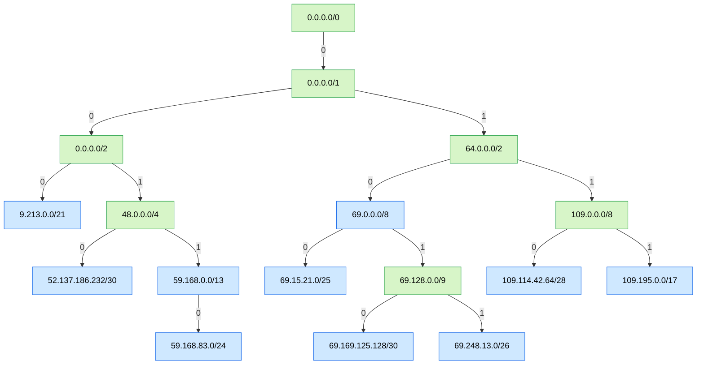

# Architecture

This document describes how `Bitvantage.InternetProtocol.NetworkPrefixLookup` stores network prefixes and answers
longest-prefix-match queries. It is written for people who want to change the internals, in particular to make
lookups faster. For usage examples see the [README](../README.md).

## Contents

1. [Purpose](#purpose)
2. [Repository layout](#repository-layout)
3. [Public types](#public-types)
4. [The data structure](#the-data-structure)
5. [Operations](#operations)
6. [Concurrency model](#concurrency-model)
7. [Diagnostics](#diagnostics)
8. [Performance](#performance)
9. [Testing and benchmarking](#testing-and-benchmarking)
10. [Known issues](#known-issues)

## Purpose

The library answers one question quickly: given an IP address, which stored network prefix is the most specific one
that contains it? That is the routing-table "longest prefix match" problem. It can also return every stored prefix
that contains an address, and it accepts a prefix instead of an address as the query.

The library depends on one package, `Bitvantage.InternetProtocol.NetworkPrefix`. That package provides the
`NetworkPrefix` type, which parses prefixes and exposes them as integer bit masks (`NetworkBits`, `NetworkMaskBits`,
`Length`, `AddressLength`). It also provides prefix arithmetic such as `Contains` and `GetContainingNetwork`.

## Repository layout

| Path | Contents |
| --- | --- |
| `Bitvantage.InternetProtocol.NetworkPrefixLookup/NetworkPrefixLookupBase.cs` | The trie: storage, lookup, insert, remove and visualization. Almost all logic lives here. |
| `Bitvantage.InternetProtocol.NetworkPrefixLookup/NetworkPrefixLookup.cs` | Public entry points: a prefix set and a prefix-to-value map. |
| `Bitvantage.InternetProtocol.NetworkPrefixLookup/NetworkPrefixKey.cs` | The stored item records. |
| `Bitvantage.InternetProtocol.NetworkPrefixLookup/ConcurrenceNetworkPrefixLookup.cs` | Variants that lock around writes. |
| `Test/` | NUnit tests. Most compare the text rendering of the trie with an expected string. |
| `PerformanceTest/` | BenchmarkDotNet benchmarks for lookup and insert. |
| `Documentation/Media/` | Tree images used by the README. |

## Public types

```text
NetworkPrefixKey                                 record: the stored item, identified by Prefix
└── NetworkPrefixKeyValuePair<TValue>            record: adds Value

NetworkPrefixLookupBase<TValue>                  abstract: all trie logic (lookup, insert, remove, diagnostics)
├── NetworkPrefixLookup                          TValue = NetworkPrefixKey (a prefix set)
│   └── ConcurrenceNetworkPrefixLookup           locks write methods
└── NetworkPrefixLookup<TValue>                  TValue = NetworkPrefixKeyValuePair<TValue> (a prefix map)
    └── ConcurrenceNetworkPrefixLookup<TValue>   locks write methods
```

- **`NetworkPrefixLookupBase<TValue>`** holds all of the logic. `TValue` must derive from `NetworkPrefixKey`, so every
  stored item carries its own prefix. The `new()` constraint on `TValue` is declared but not used.
- **`NetworkPrefixLookup`** is a set of prefixes. Lookups return the matching `NetworkPrefixKey`.
- **`NetworkPrefixLookup<TValue>`** maps prefixes to values. Lookups return a `NetworkPrefixKeyValuePair<TValue>`, so
  the caller gets both the matching prefix and its value.
- **`ConcurrenceNetworkPrefixLookup`** and **`ConcurrenceNetworkPrefixLookup<TValue>`** wrap write methods in a lock so
  that several threads can write. Reads stay lock free.

A `string` such as `"10.0.0.0/8"` converts implicitly to `NetworkPrefix`, so `lookup.Add("10.0.0.0/8")` works.

## The data structure

### A path-compressed binary trie per address family

Each lookup instance keeps two independent tries, `RootV4` and `RootV6`. Requests go to one or the other based on the
address family, so IPv4 and IPv6 never share nodes.

Each trie is a **path-compressed binary trie**, also called a radix tree. Every node branches on exactly one bit, but
the edge from a parent to a child may skip any number of bits. The README calls this a "variable stride trie"; the
variable part is the length of the skipped run, not the branching factor.

### Node kinds

| Kind | `HasValue` | Purpose | Children |
| --- | --- | --- | --- |
| Root | either | The `/0` prefix, always present. It is a value node only if `0.0.0.0/0` or `::/0` was added. | 0 to 2 |
| Value node | `true` | Holds an item that the caller added. | 0 to 2 |
| Routing node | `false` | Joins two subtrees whose prefixes have no stored common ancestor. The README calls these "container nodes". | exactly 2 |

### Bit layout

`NetworkPrefix` exposes prefixes as right-aligned `UInt128` values. An IPv4 prefix occupies the low 32 bits and an
IPv6 prefix uses all 128. Address bit `i`, counted from the most significant bit of the address, sits at `UInt128` bit
position `AddressLength - 1 - i`. `ToUInt128` converts an `IPAddress` into the same layout.

Each node caches these fields from its prefix so that the lookup loop reads only the node itself:

| Field | Meaning | Example for `69.0.0.0/8` |
| --- | --- | --- |
| `NetworkBits` | The network address bits. | `0x45000000` |
| `NetworkMaskBits` | The mask for the prefix length. | `0xFF000000` |
| `Prefix` | The prefix length. | `8` |
| `AddressLength` | 32 or 128. | `32` |
| `SplitMask` | One bit set at the first bit after the prefix: `1 << (AddressLength - Prefix - 1)`. | `0x00800000` |

`GetSlot(bits)` returns 0 when `bits & SplitMask` is zero and 1 otherwise. Slot 0 is therefore the lower half of the
node's address space and slot 1 the upper half. A key `k` is contained in a node when
`(k & NetworkMaskBits) == NetworkBits`.

For a full-length prefix (`/32` or `/128`) the shift amount is `-1`. `UInt128` masks shift amounts to 7 bits, so
`SplitMask` becomes bit 127. That is harmless because such nodes never have children.

### Invariants

The insert and remove code maintain these rules. Any optimization must keep them, or replace them deliberately.

1. A child's prefix is strictly longer than its parent's prefix and is contained in it.
2. The child in slot `b` has bit `b` at position `parent.Prefix` of its address.
3. Every routing node except the root has exactly two children.
4. A routing node's prefix is the longest prefix common to its two children, which is what
   `NetworkPrefix.GetContainingNetwork` computes.
5. Because of rules 1 to 4, the shape of the trie depends only on the set of stored prefixes, never on the order of
   inserts and removes. The tests `Add_IPv4_09` and `Delete_IPv4_03` check this.

### Example

The README's quick-start prefixes produce this IPv4 trie. Blue nodes hold values and green nodes are routing nodes.
Edge labels are child slots.



The same trie as `ToTextTree` prints it. `@` marks routing nodes and the bracketed number is the child slot:

```text
@0.0.0.0/0
└──@0.0.0.0/1[0]
   ├──@0.0.0.0/2[0]
   │  ├──9.213.0.0/21[0]
   │  └──@48.0.0.0/4[1]
   │     ├──52.137.186.232/30[0]
   │     └──59.168.0.0/13[1]
   │        └──59.168.83.0/24[0]
   └──@64.0.0.0/2[1]
      ├──69.0.0.0/8[0]
      │  ├──69.15.21.0/25[0]
      │  └──@69.128.0.0/9[1]
      │     ├──69.169.125.128/30[0]
      │     └──69.248.13.0/26[1]
      └──@109.0.0.0/8[1]
         ├──109.114.42.64/28[0]
         └──109.195.0.0/17[1]
```

## Operations

### Longest-prefix match: `TryGetMatch(IPAddress)`

This is the hot path.

```text
node = root(address family)          // /0 always contains the address
bits = ToUInt128(address)
best = null
do:
    if node.HasValue: best = node
    node = node.Children[node.GetSlot(bits)]
while node != null and (bits & node.NetworkMaskBits) == node.NetworkBits
return best
```

The containment check is needed at every step because a path-compressed edge can skip bits that the slot choice did
not look at. The walk visits one node per trie level, so the cost is proportional to the depth of the path, which is at
most 33 nodes for IPv4 and 129 for IPv6.

Looking up `69.248.13.12` in the example visits six nodes: the root, `0.0.0.0/1`, `64.0.0.0/2`, `69.0.0.0/8`,
`69.128.0.0/9` and `69.248.13.0/26`. The next slot of `69.248.13.0/26` is empty, so the walk stops, and the most
recent value node, `69.248.13.0/26`, is the answer.

### All matches: `TryGetMatches`

The same walk, but every value node on the path is added to a new list. Results are ordered from least specific to
most specific. For `69.248.13.12` the result is `69.0.0.0/8` then `69.248.13.0/26`.

### Prefix queries

`TryGetMatch(NetworkPrefix)` and `TryGetMatches(NetworkPrefix)` use the prefix's `NetworkBits` as the key and also stop
when a node's prefix is longer than the query, because a more specific prefix cannot contain it. The result is the
longest stored prefix that equals or contains the query. These overloads skip `ToUInt128`, so
`TryGetMatch(NetworkPrefix)` does not allocate at all.

### Insert: `TryAdd`

`WalkTree` records the path from the root to the deepest node that contains the new prefix and is no longer than it.
Call that last node the parent. One of four cases then applies.

```text
          Case 2: empty slot        Case 3: new contains child     Case 4: siblings

before    parent                    parent                         parent
          └── (empty)               └── child                      └── child

after     parent                    parent                         parent
          └── NEW                   └── NEW                        └── @routing
                                        └── child                      ├── child
                                                                       └── NEW
```

Which slot each node lands in depends on its address bits; the sketch ignores that.

1. **Exact match.** If the parent already has the new prefix, a value node makes the insert a duplicate and it returns
   `false`. A routing node is converted in place into a value node.
2. **Empty slot.** The new node becomes a leaf in the parent's slot.
3. **New prefix contains the existing child.** The new node is inserted between the parent and that child.
4. **Siblings.** A routing node for `GetContainingNetwork(new, child)` is created with the new node and the existing
   child as its two children, then linked into the parent's slot. The existing child cannot contain the new prefix,
   because `WalkTree` would have descended into it.

In cases 2 to 4 the new nodes are fully linked before one reference write to `parent.Children[slot]` makes them
visible. See [Concurrency model](#concurrency-model).

### Remove: `TryRemove`

1. `WalkTree` records the path. If the last node's prefix is not exactly the requested prefix, the method returns
   `false`.
2. The node is demoted to a routing node: `HasValue` is cleared and its item is replaced with a plain
   `NetworkPrefixKey`, so the trie no longer references the caller's value.
3. The method walks back up the recorded path and prunes routing nodes that are no longer needed. A routing node with
   no children is unlinked from its parent. A routing node with one child is replaced in its parent's slot by that
   child. Value nodes are skipped. The walk stops at the first routing node that still has two children. The root is
   never pruned.

### Clear

`Clear` replaces both roots with new empty roots. Readers already walking the old tries finish against the old nodes.

## Concurrency model

The base classes promise lock-free reads with one writer at a time. The writer follows these rules so that a reader
never sees a broken trie:

- **Structural changes are published with a single reference write.** Inserts build the new node, and the routing node
  if one is needed, completely before storing it into `parent.Children[slot]`. Removals unlink or splice with a single
  store into the parent's slot.
- **Readers tolerate either version.** A reader that passes a node just before or just after a write sees a valid trie
  either way, possibly without the prefix that is being added or removed.
- **Root replacement is a single reference write.** `Clear` swaps `RootV4` and `RootV6`.

There is no `volatile`, `Interlocked` or memory barrier anywhere in the code. The rules above rely on the .NET memory
model making a newly constructed object's fields visible before a reference to it is published. Two in-place updates
go beyond that guarantee:

- **Routing node to value node** (insert case 1) writes `ValuePair` and then `HasValue`. On x86 and x64 stores are not
  reordered, so a reader that sees `HasValue == true` also sees the new item. On weakly ordered CPUs such as ARM64,
  nothing enforces that order.
- **Value node to routing node** (remove step 2) clears `HasValue` and then replaces `ValuePair` with a plain
  `NetworkPrefixKey`. A reader that already saw `HasValue == true` casts `ValuePair` to `TValue` after the loop. For
  `NetworkPrefixLookup<TValue>` that cast can fail with `InvalidCastException`. This race was found by reading the code
  and has not been reproduced.

`Count` is a plain `long` updated with `++` and `--`, so it is only meaningful with a single writer.

The `Concurrence*` classes add a private lock around their overridden write methods. Some write paths are not
overridden and so are not locked; see [Known issues](#known-issues).

Any optimization of the read path must preserve these publication rules. In particular, a node that readers can reach
must never be observed half updated, and any change that mutates nodes in place needs explicit ordering.

## Diagnostics

- **`ToTextTree(version, displayText)`** prints the trie as indented text. Routing nodes start with `@` and the
  bracketed number is the child slot. The unit tests compare against this exact output, which makes it the main way to
  assert the shape of the trie.
- **`ToDotTree(version, displayText)`** returns Graphviz DOT source. Each node shows its prefix and its address in
  binary, with the bits past the prefix length in gray and the bit that chose the node's slot underlined.
- **`ToDotSvgTree(filename, version, displayText, dotPath)`** writes the DOT file and runs Graphviz `dot` to produce an
  SVG. The default `dotPath` is the Windows install location, so other platforms must pass the path explicitly.

## Performance

### Measured baseline

These numbers come from a throwaway probe run on .NET 7 against the code at the time of writing. It used the same
seeded data as `PerformanceTest/Program.cs`: random IPv4 prefixes from seed 11 and random addresses from seed 12. Node
counts and path lengths are deterministic and do not depend on the runtime. Allocation figures come from
`GC.GetAllocatedBytesForCurrentThread`.

| Measure | Value |
| --- | --- |
| Distinct prefixes inserted | 96,944 of 100,000 generated |
| Value nodes / routing nodes / total | 96,944 / 75,986 / 172,930 |
| Maximum node depth | 21 |
| Nodes visited per lookup, average over 1,000,000 addresses | 15.87 |
| Nodes visited per lookup, maximum | 22 |
| Bytes allocated per `TryGetMatch(IPAddress)` | 64 |
| Bytes allocated per `TryGetMatch(NetworkPrefix)` | 0 |
| Bytes allocated per `TryGetMatches(IPAddress)` | about 391 |
| Bytes allocated per insert while building | about 1,077 |
| Bytes retained per stored prefix | about 400, not counting the caller's `NetworkPrefix` objects |

Distribution of nodes visited per lookup, including the root:

| Nodes visited | 13 | 14 | 15 | 16 | 17 | 18 | 19 | 20 | 21 | 22 |
| --- | --- | --- | --- | --- | --- | --- | --- | --- | --- | --- |
| Lookups | 2,375 | 68,643 | 293,417 | 387,060 | 195,762 | 46,362 | 5,931 | 440 | 9 | 1 |

In a 4-core cloud container, BenchmarkDotNet measured between 0.84 and 0.86 million lookups per second on both
.NET 7 and .NET 10; see the next section. The README reports 3.38 million per second on an AMD Ryzen 7 7800X3D. Use timings only
for relative comparisons on the same machine.

### .NET 7 versus .NET 10

The projects were moved from .NET 7 to .NET 10. Both runtimes were measured with BenchmarkDotNet 0.15.8 on the same
machine: a 4-core Intel Xeon 2.80 GHz cloud container running Ubuntu 24.04, with .NET 7.0.20 and .NET 10.0.13.

This container drifts by about 10% between sessions. The .NET 7 lookup benchmark measured 1,048 ms in one session and
1,160 ms in another. The authoritative comparison therefore ran all runtimes in one BenchmarkDotNet session, using a
scratch project that compiled the library source for both runtimes. The third job is .NET 10 with the environment
variable `DOTNET_GCgen0size=0x10000000`, which raises the Gen0 budget to 256 MB.

| Benchmark | .NET 7 | .NET 10 | .NET 10, 256 MB Gen0 budget |
| --- | --- | --- | --- |
| `IpNetworkLookupX1M`, mean | 1,160 ms | 1,194 ms | 1,040 ms |
| `IpNetworkLookupX1M`, ratio to .NET 7 | 1.00 | 1.04 ± 0.10 | 0.90 ± 0.09 |
| `AddX100K`, mean | 157 ms | 339 ms | 196 ms |
| `AddX100K`, ratio to .NET 7 | 1.00 | 2.18 ± 0.19 | 1.26 ± 0.13 |
| `AddX100K`, garbage collections per build | none | 5.5 Gen0, 5 Gen1 | 0.3 Gen0 |
| `AddX100K`, allocated per build | 99.6 MB | 94.6 MB | 94.6 MB |

Separate full runs of `PerformanceTest`, one per runtime, also covered the other two benchmarks:

| Benchmark | .NET 7 | .NET 10 |
| --- | --- | --- |
| `ConcurrenceAddX100K` | 176 ms | 316 ms |
| `HashTableLookup` | 128 ms | 75 ms |

Findings:

- **Lookups did not get faster.** The difference is within the noise. Lookups are dominated by dependent memory loads,
  which a newer JIT cannot remove.
- **Inserts are about twice as slow on .NET 10, because of garbage collection.** On this machine .NET 10 reports
  `GCGen0MaxBudget = 17301504` from `GC.GetConfigurationVariables()`, which is 16.5 MB, exactly half of the 33 MiB L3
  cache. .NET 7 reports no such setting and never collected during a build, so its effective Gen0 budget here was over
  100 MB. A build allocates about 95 MB, so .NET 10 runs several Gen0 and Gen1 collections per build. Each Gen1
  collection has to trace the half-built trie, which is almost entirely live.
- **The Gen0 budget explains most of the insert gap, not all of it.** With a 256 MB budget, .NET 10 is still about
  25% slower than .NET 7 on inserts. The cause of the remainder is unknown.
- **Other code did get faster.** The `Dictionary` baseline ran 41% faster on .NET 10.

The Gen0 budget is a process-wide setting that belongs to the application, not the library. Applications can raise it
with `GCgen0size` in `runtimeconfig.json` or the `DOTNET_GCgen0size` environment variable. The library-level remedy
is to allocate less per insert and per lookup; see the candidates below.

### Why paths are about 16 nodes deep

The README says depth is "generally in the single digits". That holds for small or tightly clustered tables, but not
for large random ones. A binary trie over `N` random keys branches fully for roughly the first `log2(N)` levels, and
`log2(100,000)` is about 16.6. Path compression only removes chains of single-child nodes, and there are few of those
near the top of a dense trie. The visited-node distribution above matches that estimate. Real routing tables are more
clustered than random data, so they will differ.

### Cost model for one lookup

Each visited node costs:

1. A load of `node.Children`, a separate array object, plus a bounds check.
2. A load of the child `Node` object.
3. Two 128-bit operations: an AND for the slot test and a masked compare for containment. `UInt128` arithmetic is
   done as pairs of 64-bit operations, even for IPv4 keys that fit in 32 bits.

Steps 1 and 2 are dependent memory loads. With about 173,000 nodes the trie does not fit in the L1 or L2 caches, so
the lookup is dominated by pointer chasing. The two `TryGetMatch` overloads run at similar speed even though one
allocates and the other does not, which supports that view.

The code marks known costs with `PERF:` comments. Search for `PERF:` to find them.

### Optimization candidates

These are ideas for the planned performance work, roughly ordered from least to most invasive. None of them has been
implemented or measured yet.

1. **Remove the allocations in `ToUInt128`.** Use `IPAddress.TryWriteBytes` into a stack buffer and
   `BinaryPrimitives.ReadUInt32BigEndian` or `ReadUInt64BigEndian`. This removes 64 bytes of garbage per lookup and
   does not touch the trie.
2. **Use cached fields in `TryGetMatches`.** Both overloads read `ValuePair.Prefix.NetworkBits` and
   `NetworkMaskBits` instead of the copies on the node. Letting callers pass in a reusable list would also remove the
   per-call list allocation.
3. **Store children as two fields instead of an array.** `Left` and `Right` fields, or an inline buffer, remove one
   dependent load and one bounds check per level. The diagnostics code indexes children by slot, so it would need a
   small accessor.
4. **Shrink the node.** `NetworkMaskBits` and `SplitMask` can both be derived from `Prefix` and `AddressLength`, for
   example through small static lookup tables. A smaller node means more of the trie fits in cache.
5. **Specialize IPv4.** Separate IPv4 nodes that use `uint` keys would avoid 128-bit arithmetic for the common case.
   The roots are already separate, so the split is natural.
6. **Index the top levels.** A direct-indexed table over the first 8 or 16 address bits would let a lookup skip every
   node above that depth. In a dense trie that is most of the 16-node path measured above. Each table entry would need the
   deepest trie node under it and the best value node above it, and every insert and remove would have to keep the
   table in step. This is the largest potential win and the largest change. Layering it over the existing binary trie
   keeps `ToTextTree` and the shape tests valid.
7. **Allocate less per insert.** An insert allocates about 1 KB: the caller's item record, the `Node`, its separate
   two-slot `Children` array, sometimes a routing node with its own array and key record, and the
   `List<NodeHistory>` that `WalkTree` grows on every insert and remove. A pooled or stack-allocated path buffer of at
   most 129 entries would replace the list, and candidate 3 removes the arrays. On .NET 10 this matters more than on
   .NET 7, because the smaller Gen0 budget turns these allocations into Gen1 collections; see
   [.NET 7 versus .NET 10](#net-7-versus-net-10).

Changes that should be decided deliberately:

- **Target framework.** The projects now target .NET 10. A package built only for `net10.0` cannot be used by
  applications on .NET 8 or .NET 9. Multi-targeting, for example `net8.0;net10.0`, would keep them, at the cost of
  testing and benchmarking each target.
- **Public API.** The package is published on NuGet at version 2.0.0. Signature changes are breaking.

Whatever the change, keep the [invariants](#invariants) and the [concurrency rules](#concurrency-model), run the unit
tests, and compare benchmarks before and after on the same machine.

## Testing and benchmarking

### Unit tests

`Test/NetworkPrefixLookupTest.cs` uses NUnit. Most tests build a trie and compare `ToTextTree` with an expected string,
so they verify the exact shape of the trie and not just lookup results. Notable tests:

| Test | What it checks |
| --- | --- |
| `Add_IPv4_09` | Random insertion orders of the same prefixes produce identical trees. |
| `Add_IPv4_12` | One writer adding and removing prefixes while one reader looks up an address. |
| `Delete_IPv4_03` | Adding then removing 2,000 of 10,000 prefixes gives the same tree as never adding them. |
| `Add_IPv6_02` | IPv6 insert shapes, including IPv4-embedded addresses. |
| `TryGetMatch_IPv4_01` | Prefix queries return the longest containing prefix. |

The `ToDotSvgTree_*` tests are disabled because they need Graphviz and write to `c:\temp`.

All 19 tests pass on Linux and Windows. The expected trees are raw string literals, so they take the line endings of
the checked-out file, while `ToTextTree` uses `Environment.NewLine`. The repository's `.gitattributes` sets
`text=auto`, which checks files out with the platform's native line endings, so the two agree.

### Benchmarks

`PerformanceTest/Program.cs` uses BenchmarkDotNet 0.15.8 with `[MemoryDiagnoser]`, so results include allocations
and garbage collection counts. Command-line arguments are passed to BenchmarkDotNet, so options such as `--filter` and
`--artifacts` work. The `--runtimes` option needs a project that targets every requested runtime, which this one does
not. Each benchmark method is one operation over a full data set:

| Benchmark | One operation |
| --- | --- |
| `IpNetworkLookupX1M` | 1,000,000 `GetMatch(IPAddress)` calls against about 97,000 prefixes. |
| `AddX100K` | Builds a new `NetworkPrefixLookup<string?>` from about 97,000 prefixes. |
| `ConcurrenceAddX100K` | The same build with `ConcurrenceNetworkPrefixLookup<string?>`. |
| `HashTableLookup` | Baseline: 1,000,000 exact-match `Dictionary<IPAddress, object>` lookups. |

There is no IPv6 benchmark and no prefix-query benchmark. Adding them would make the planned performance work easier
to judge.

## Known issues

These were found while writing this document. Behavior was intentionally left unchanged; each one is also marked with a
`KNOWN ISSUE:` comment in the code.

| Issue | Effect | Location |
| --- | --- | --- |
| Insert case 2 does not increment `Count`. | `Count` is too low. With the benchmark data it reports 91,471 instead of 96,944. | `NetworkPrefixLookupBase.TryAdd` |
| `TryRemove` does not check `HasValue`. | Removing a routing node's prefix, or `/0` from an empty trie, returns `true` and decrements `Count`, which can go negative. | `NetworkPrefixLookupBase.TryRemove` |
| `Clear` does not reset `Count`. | `Count` is wrong after `Clear`. | `NetworkPrefixLookupBase.Clear` |
| Remove replaces the item before a reader casts it. | A concurrent reader of `NetworkPrefixLookup<TValue>` can get `InvalidCastException`. Found by inspection, not reproduced. | `NetworkPrefixLookupBase.TryRemove` |
| No memory ordering on in-place node updates. | On ARM64 a reader may see `HasValue` and `ValuePair` out of order. | `NetworkPrefixLookupBase.TryAdd`, `TryRemove` |
| The locking classes do not override every write method. | `TryAdd(TValue)` is unlocked in both classes. `Clear` and `GetOrAdd` are unlocked in the generic class. | `ConcurrenceNetworkPrefixLookup.cs` |
| `GetOrAdd` uses a longest-prefix match, not an exact match. | If a shorter containing prefix exists, it is returned and nothing is added. | `NetworkPrefixLookup<TValue>.GetOrAdd` |
| `NetworkPrefixLookup<TValue>` declares `IEnumerable` without implementing it. | Enumerating throws `NotImplementedException`. | `NetworkPrefixLookup.cs` |
| `ToDotSvgTree` defaults to a Windows path for `dot`. | Other platforms must pass `dotPath`. | `NetworkPrefixLookupBase.ToDotSvgTree` |

Smaller inconsistencies:

- The README refers to `GetMatchs` and `ConcurrentPrefixNetworkLookup`. The actual names are `GetMatches` and
  `ConcurrenceNetworkPrefixLookup`.
- The library project file removes `NetworkKey.cs` from compilation, but that file no longer exists.
